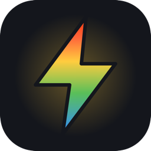
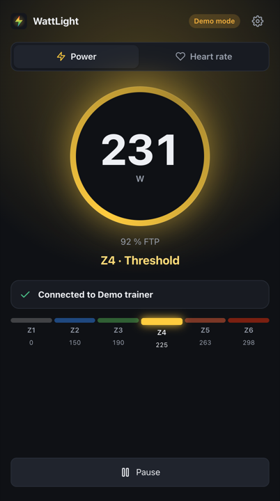
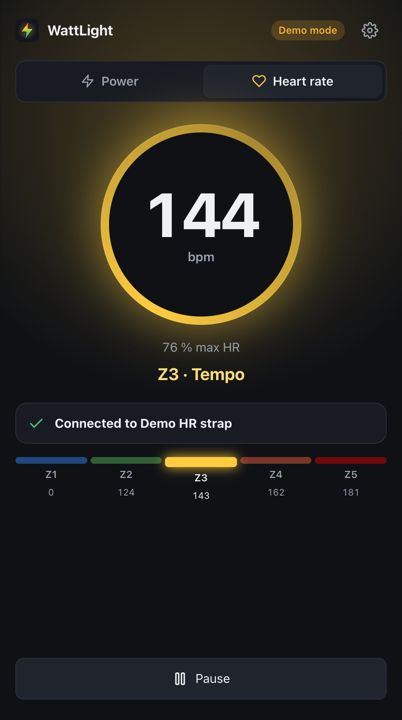
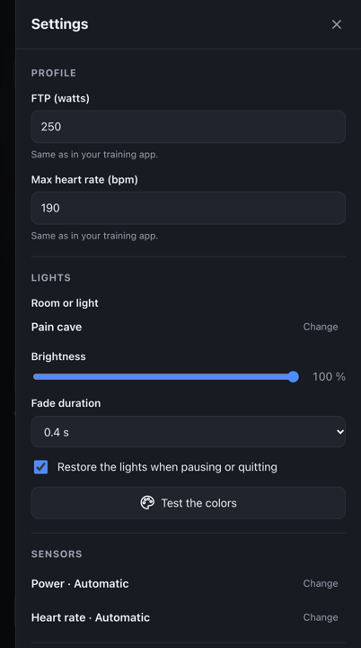
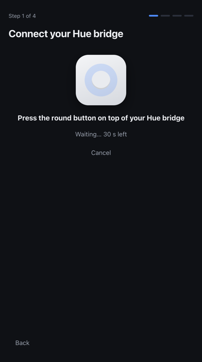
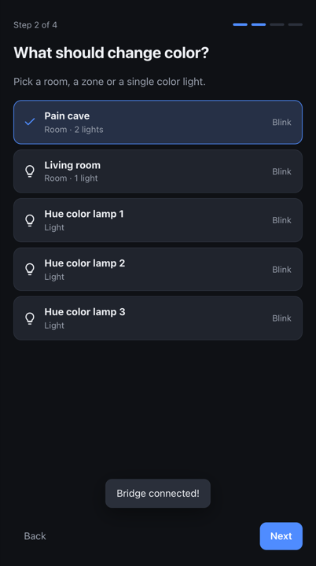
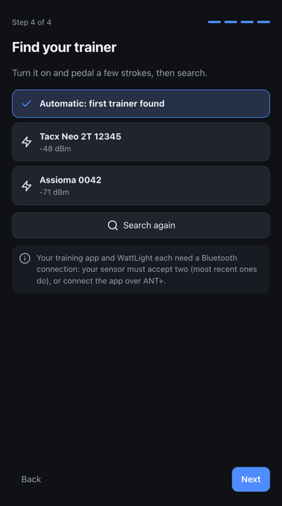

<p align="center">
  
</p>

<h1 align="center">WattLight</h1>

<p align="center">
  Your Philips Hue lights take the color of your training zone, live,<br>
  from your smart trainer, power meter or heart rate strap.
</p>

<p align="center">
  
  
</p>

<p align="center">
  
  
  
</p>

Push harder and the room turns from blue to green, yellow, orange, then red, like the power bar
of your training app. WattLight reads your sensor over Bluetooth, works out your zone and drives
a Hue room, zone or single light through your Hue bridge. When you stop, the lights go back to
how they were.

## Features

- **Power or heart rate**, one click to switch. Power (the default) reacts instantly; heart rate follows the effort with a 30 to 90 s lag.
- **Classic training zones**: six power zones from your FTP, five heart rate zones from your max HR.
- **Two-minute setup**: finds the Hue bridge on your network, pairs it with the link button, lets you pick and blink the lights, finds your sensor.
- **Keeps looking for you**: trainer still off, strap not on yet, Bluetooth disabled, bridge unreachable… the app tells you what to do and retries on its own.
- **Smooth and steady**: the usual 3 s rolling power, and a small hysteresis so the lights do not flicker when you ride on a zone boundary.
- **Restores your lights** when you pause or quit.
- **Lightweight**: a native window using the webview already in your system (no bundled browser), English and French.
- **Private**: everything stays on your local network. No account, no cloud, no telemetry.

## Zones

**Power** (% of FTP, 3 s average):

| Zone | % FTP | Color |
| --- | --- | --- |
| Z1 Recovery | < 60 % | grey |
| Z2 Endurance | 60–75 % | blue `#338CFF` |
| Z3 Tempo | 76–89 % | green `#59BF59` |
| Z4 Threshold | 90–104 % | yellow `#FFCC3F` |
| Z5 VO2max | 105–118 % | orange `#FF663A` |
| Z6 Anaerobic | > 118 % | red `#FF340C` |

**Heart rate** (% of max HR):

| Zone | % max HR | Color |
| --- | --- | --- |
| Z1 Endurance | < 65 % | blue |
| Z2 Moderate | 65–75 % | green |
| Z3 Tempo | 75–85 % | yellow |
| Z4 Threshold | 85–95 % | orange |
| Z5 Anaerobic | > 95 % | red |

Both tables can be replaced by your own zones in the [settings file](#settings-file).

## What you need

- A **Philips Hue bridge** with color lights (any Hue color bulb, strip, Play bar, Go…).
- A **Bluetooth LE sensor** using the standard profiles:
  - power: the *Cycling Power* service, offered by nearly every smart trainer (Tacx, Wahoo KICKR, Elite, Saris…) and power meter;
  - heart rate: the *Heart Rate* service (Garmin HRM, Polar H9/H10, Wahoo TICKR, watches that broadcast HR…).
- A computer with Bluetooth 4.0 or later, on the same network as the bridge:
  - macOS 11 or later (Apple silicon or Intel);
  - Windows 10 (1703) or 11, x64;
  - Linux x64 or arm64 (Raspberry Pi 4/5 included) with BlueZ.

> **Sharing the sensor with your training app.** Your training app and WattLight each need their own Bluetooth connection.
> Most recent trainers and straps accept two (a Garmin HRM-Pro takes two Bluetooth connections plus ANT+).
> If yours accepts only one, connect the training app over ANT+ (or through its companion phone app) and leave Bluetooth to WattLight.

## Install

Download the bundle for your system from the [latest release](../../releases/latest). Each bundle contains
everything it needs, including its own Node.js runtime: there is nothing else to install.

### macOS

1. Unzip `wattlight-<version>-darwin-arm64.zip` (Apple silicon) or `…-darwin-x64.zip` (Intel) and move **WattLight** to *Applications*.
2. The app is not notarized by Apple. The first time, open it, then go to *System Settings › Privacy & Security* and click **Open Anyway**.
   (Or run `xattr -dr com.apple.quarantine /Applications/WattLight.app` once.)
3. Allow **Bluetooth** and **Local Network** access when macOS asks.

Logs go to `~/Library/Logs/wattlight.log`.

### Windows

1. Unzip `wattlight-<version>-win32-x64.zip`, for instance in `Documents`.
2. Double-click **wattlight.cmd**. If SmartScreen warns you, click *More info › Run anyway*.
   A minimized console window holds the logs; closing it quits the app.

The window uses Microsoft Edge WebView2, included in Windows 11 and installed with Edge on Windows 10.

### Linux

```bash
tar -xzf wattlight-<version>-linux-x64.tar.gz
./wattlight/wattlight                     # start
./wattlight/install-desktop-entry.sh       # optional: add it to your applications menu
```

Bluetooth goes through BlueZ over D-Bus: no root needed, `bluetoothd` keeps running.
The native window needs WebKitGTK 4.1 (`sudo apt install libwebkit2gtk-4.1-0 libxdo3` on Debian/Ubuntu);
without it, WattLight opens in your browser instead.

### From source

With Node.js 26 or later:

```bash
git clone <this repository> && cd wattlight
npm ci
npm start
```

## First launch

The setup walks you through four steps, each saved right away:

1. **Hue bridge**: pick the bridge found on your network (or type its IP address, shown in the Hue app under *Settings › Bridges*), then press the round button on top of the bridge.
2. **Lights**: pick a room, a zone or a single color light. *Blink* shows you which one it is.
3. **Power or heart rate**, with your FTP or max HR (the same values as in your training app).
4. **Sensor**: wake it up, search, and pick it, or keep *Automatic* to use the first one found.

<p align="center">
  
  
  
</p>

Then ride. Everything can be changed later with the ⚙ button: FTP and max HR, lights, brightness,
fade duration, sensors, bridge, language. *Test the colors* cycles your lights through every zone.

## Troubleshooting

The status card under the gauge tells you what is going on. The most common messages:

| Message | What to do |
| --- | --- |
| *Trainer not found* | Turn the trainer on and pedal a few strokes: most trainers sleep until they move. WattLight searches again every 5 s. |
| *Cannot connect to …* | The sensor is probably already used by another app over Bluetooth. See *Sharing the sensor with your training app* above. |
| *… stopped sending data* | The trainer went to sleep or the strap lost contact. Pedal, or moisten the strap's electrodes. |
| *No skin contact* | Moisten the electrodes and tighten the strap just below your chest. |
| *WattLight is not allowed to use Bluetooth* | macOS: *System Settings › Privacy & Security › Bluetooth*, allow WattLight (or your terminal when started from source), then restart the app. |
| *Cannot reach the Hue bridge* | Check that the bridge is on and that the computer is on the same network (not a guest Wi-Fi). On macOS, allow *Local Network* access. |
| *The Hue bridge refused access* | The pairing was removed in the Hue app: *Settings › Hue bridge › Change*, then press the bridge button again. |

No bridge found automatically? Type its IP address: discovery uses mDNS and the Philips discovery
service, and some routers block both.

## Command line

The app is also a command-line tool: `./wattlight` in the Linux bundle,
`/Applications/WattLight.app/Contents/MacOS/wattlight` on macOS, `node.exe app\dist\src\main.js`
in the Windows folder, `node dist/src/main.js` from source.

```text
wattlight [options]        open the app
wattlight run [options]    drive the lights from the terminal, without the app window
wattlight scan [--source]  list the Bluetooth sensors in range

  --demo                 simulated sensor (the Hue lights are real)
  --sandbox              everything simulated, with a separate settings file: no hardware needed
  --browser              open the app in the default browser instead of a window
  --source <power|hr>    power (default) or heart rate          (run, scan)
  --ftp <watts>          FTP                                     (run)
  --max-hr <bpm>         max heart rate                          (run)
  --brightness <1-254>   brightness                              (run)
```

`run` uses the saved settings (set up the bridge once in the app), which makes it handy on a
Raspberry Pi without a screen. Command-line values are not saved.

## Settings file

Settings live in `~/.config/wattlight/config.json` (`%APPDATA%\wattlight\config.json` on Windows,
`$XDG_CONFIG_HOME/wattlight` when set). The app writes it; you only need to edit it for the advanced keys:

| Key | Default | Meaning |
| --- | --- | --- |
| `source` | `"power"` | `"power"` or `"hr"` |
| `ftp` / `maxHr` | `250` / `190` | references of the zones |
| `brightness` | `254` | 1–254 |
| `transitionDs` | `4` | fade duration, in tenths of a second |
| `restoreOnExit` | `true` | put the lights back when pausing or quitting |
| `powerMeter` / `hrm` | `null` | `{ "id", "name" }` of the sensor; `null` = first one found |
| `powerSmoothingS` | `3` | power rolling average, in seconds |
| `hysteresisW` / `hysteresisBpm` | `5` / `3` | margin before going down a zone |
| `powerZones` / `hrZones` | `null` | custom zones, see below; `null` = the zones above |
| `language` | `null` | `"en"`, `"fr"`, or `null` for the system language |

Custom zones, as a share of FTP or max HR:

```json
"powerZones": [
  { "name": "Easy", "fromPct": 0, "color": "#338CFF" },
  { "name": "Hard", "fromPct": 0.9, "color": "#FF340C" }
]
```

## Privacy and security

- Everything runs on your computer and your local network. The only Internet request is the
  optional bridge discovery through `discovery.meethue.com`.
- The app window talks to its own process through a server bound to `127.0.0.1`, protected by a
  random token drawn at each launch and by a `Host` check: web pages cannot drive it.
- The Hue access key stays in the settings file (readable by your user only) and is never sent to the UI.

## Development

Requirements: Node.js 26 or later, pinned in `.nvmrc` (tests and build scripts run TypeScript directly).

```bash
npm ci
npm run sandbox      # the whole app with a simulated bridge and sensor: no hardware needed
npm run demo         # simulated sensor, real Hue lights
npm start            # the real thing
npm run check        # typecheck + lint + tests
npm run package      # portable bundle for this machine, in release/
```

How it fits together:

```text
src/
  main.ts          command line: app, run, scan
  desktop.ts       starts the engine and the server, opens the window (or the browser), quits cleanly
  window.ts        native window process (@webviewjs/webview: WebKit, WebView2, WebKitGTK)
  server.ts        local HTTP API + server-sent events for the UI, token protected
  engine.ts        Session: sensor -> zone -> lights, status codes, watchdog, restore
  ble.ts           Bluetooth LE sensors (noble): Cycling Power and Heart Rate services
  hue.ts, mdns.ts  Hue bridge API v1, discovery, pairing
  zones.ts         training zones, hysteresis, rolling average
  config.ts        settings file, validation
  shared/          types and translations, shared with the UI
ui/                the interface: TypeScript without framework, compiled by tsc
test/              node:test suites, with in-memory fakes of the bridge and the sensor
scripts/           build and packaging
```

The engine never formats text: it publishes status codes (`notFound`, `noContact`…) that the UI and
the command line translate with `src/shared/locales/`. To add a language, copy `fr.ts`, translate it,
and register it in `src/shared/i18n.ts` and `src/config.ts`.

### Releasing

1. Update the version in `package.json` and the `CHANGELOG.md`.
2. Tag and push: `git tag v1.2.3 && git push --tags`.
3. The *Release* workflow checks, builds the five bundles (macOS arm64/x64, Windows x64, Linux x64/arm64)
   and publishes them with their SHA-256 checksums.

See [CONTRIBUTING.md](CONTRIBUTING.md) for the conventions.

## License

[MIT](LICENSE). WattLight is an independent project, not affiliated with or endorsed by Signify.
Philips Hue is a trademark of Signify Holding.
